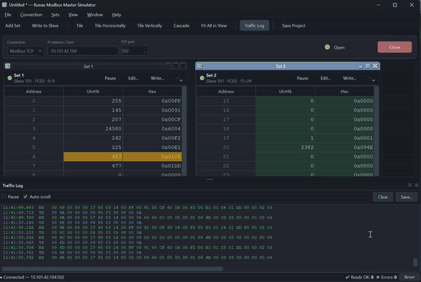
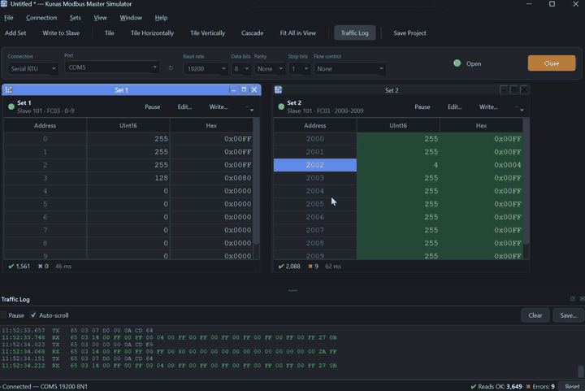
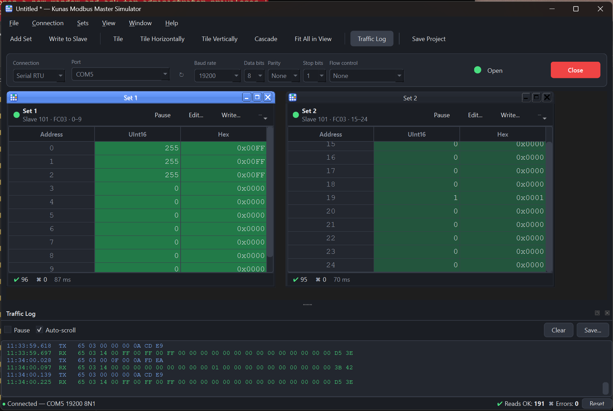
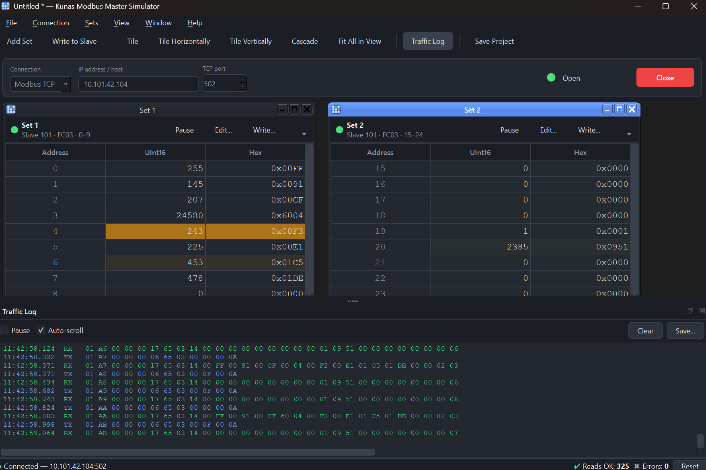

# Kuna's Modbus Master Simulator (KMMS)

A cross-platform Modbus **master** with a modern graphical interface, for macOS, Windows and Linux.
Poll any number of register ranges from serial devices or TCP slaves, watch the values update live,
write values back, and save the whole workspace as a project file.



Writing a register (FC16) from the table's context menu:



| Serial RTU | Modbus TCP |
|------------|------------|
|  |  |

## Features

**Connections**
- Serial **RTU** and **ASCII** over real COM ports, USB serial adapters and virtual ports.
  Baud rate (300 – 921600 or any custom value), 5–8 data bits, parity N/E/O/Mark/Space, 1 / 1.5 / 2
  stop bits and flow control (none, RTS/CTS, XON/XOFF).
- **Modbus TCP** and **RTU over TCP** (IP/host + port).
- Open / Close controls with a live state indicator. A lost connection (unplugged USB adapter,
  rebooted PLC) is retried automatically.

**Polling sets** - as many as you like, each in its own window:
- slave address, read function (01 coils, 02 discrete inputs, 03 holding registers,
  04 input registers), start address and length (ranges larger than one request are split
  automatically),
- **poll interval**, **response timeout** and **pause after error / timeout** per set. A set that
  is in its pause does not delay the others.

**Live view**
- Every register that is read **flashes green** on update, is marked **amber** when its value
  *changed*, and the whole set **blinks red** on a read error (with a faint red tint until the next
  success). Each highlight can be switched off and its duration set in *Preferences* - handy
  for fast poll intervals.
- Per-set counters (OK / errors / last response time or last error) and totals in the status bar.
- Value columns: UInt16, Int16, Hex, Binary, ASCII, UInt32, Int32, Float32, Hex32, UInt64, Int64,
  Float64 - with byte-swap and word-swap options for all four 32-bit byte orders.
- Write support: double-click a cell to write it (FC06 / FC16), double-click a coil to toggle it
  (FC05), or use *Write to Slave...* for FC05 / 06 / 15 / 16.
- Dockable **traffic log** of raw TX/RX frames with pause, clear and save.

**Workspace**
- Window controls: Tile, Tile Horizontally, Tile Vertically, Cascade, **Fit All in View**,
  Minimize / Restore All, Show All Sets, tabbed mode and a list of all sets.
- **Projects** (`.kmms`, human-readable JSON) store the connection settings, every polling set,
  display options and all window positions. Recent files, drag & drop of project files and
  automatic restore of the last session.

## Running from source

```bash
python3 -m venv .venv && source .venv/bin/activate     # Windows: .venv\Scripts\activate
pip install -e ".[dev]"
python run_kmms.py [project.kmms]
```

Python 3.9 or newer. On Linux, Qt needs `libxcb-cursor0` (Debian/Ubuntu) or the equivalent.

## Tests

```bash
pytest                    # ~190 tests, runs headless (Qt "offscreen" platform)
ruff check src tests
```

The test-suite talks to an **independent** Modbus implementation ([pymodbus]) for TCP, RTU and
ASCII framing, injects faults (silence, partial frames, corrupt CRC, dropped connections,
late responses), exercises real serial I/O through a pseudo-terminal (macOS/Linux) and drives the
whole GUI.

## Building the single-file binary

```bash
python packaging/build.py
```

Produces `dist/KMMS-<version>-<os>-<arch>` and smoke-tests it (`--selftest`). PyInstaller cannot
cross-compile, so each platform is built on its own OS - `.github/workflows/build.yml` does this
for Windows, Linux and macOS.

| Platform | Result                                                            |
|----------|-------------------------------------------------------------------|
| Windows  | `KMMS-<ver>-windows-x64.exe` - one executable                      |
| Linux    | `KMMS-<ver>-linux-x64` - one executable                            |
| macOS    | `KMMS-<ver>-macos-arm64.zip` containing `KMMS.app`                 |

On macOS the app is a `.app` bundle (shipped as one zip) rather than a one-file executable:
the one-file layout unpacks about 100 MB on every launch (~7 s start-up) and PyInstaller
deprecates it for bundles. The app is ad-hoc signed only; for distribution to other people sign
and notarize it with an Apple Developer ID, otherwise Gatekeeper asks to confirm the first start
(right-click > Open). Unsigned Windows executables trigger SmartScreen in the same way.

## Layout

```
src/kmms/protocol.py    PDU / RTU / ASCII / MBAP framing, CRC, LRC (pure, no I/O)
src/kmms/transport.py   serial + TCP channels, ModbusMaster (timeouts, tracing, no retries)
src/kmms/engine.py      polling thread: scheduling, error pauses, writes, reconnect
src/kmms/model.py       connection / set / project data model and JSON file format
src/kmms/formats.py     register value formats and byte/word order
src/kmms/gui/           Qt user interface (main window, set windows, dialogs, log, theme)
packaging/              icon generator, PyInstaller spec and build script
tests/                  unit, integration and GUI tests
```

The Modbus stack is a small purpose-built implementation instead of a library client because the
application needs exact per-set timeouts, no hidden retries, raw frame tracing and an
immediately interruptible Close. [pymodbus] is used by the tests only.

## License

KMMS is free for **non-commercial** use under the
[PolyForm Noncommercial License 1.0.0](LICENSE.md): personal use, hobby projects, study,
research, and use by charities, schools, public research and government institutions. Use for
a commercial purpose (for example as a tool in paid work or inside a company) is not covered;
contact the author for a commercial license.

The binaries include third-party software under its own licenses: [Qt for Python (PySide6)]
and Qt under the LGPL v3, and [pySerial] under the BSD 3-Clause license.

[pymodbus]: https://github.com/pymodbus-dev/pymodbus
[Qt for Python (PySide6)]: https://doc.qt.io/qtforpython-6/licenses.html
[pySerial]: https://github.com/pyserial/pyserial
